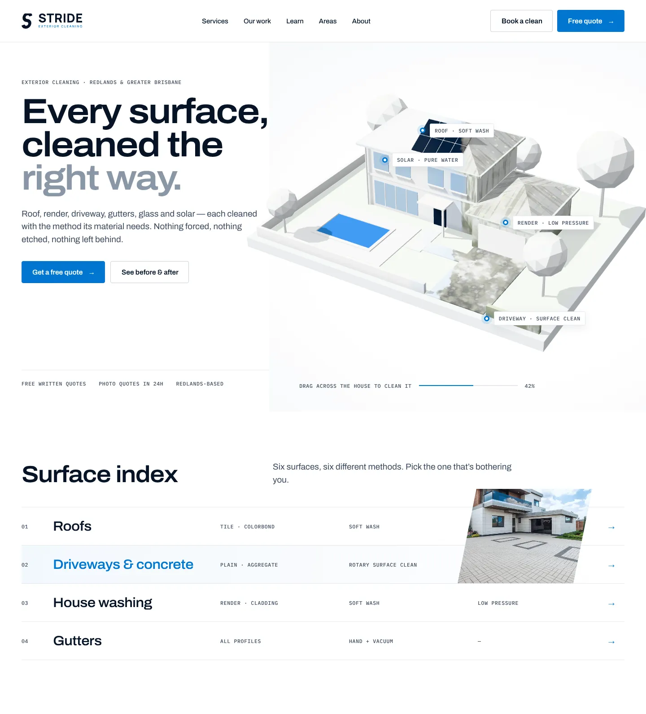
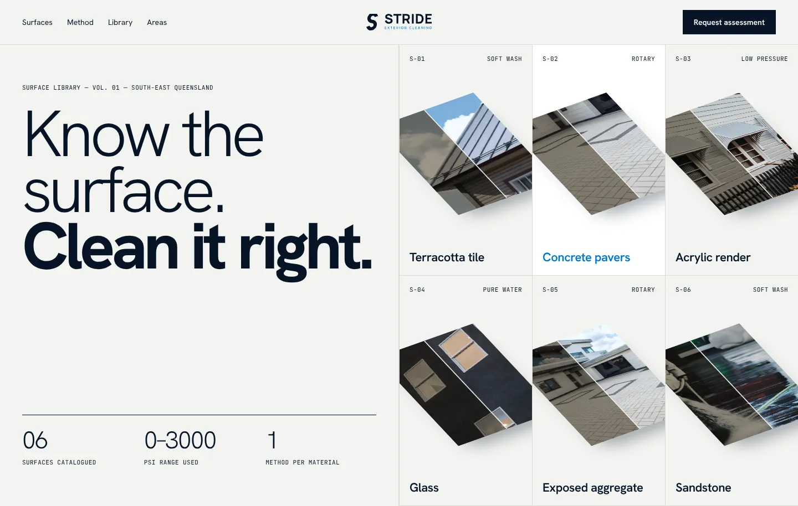
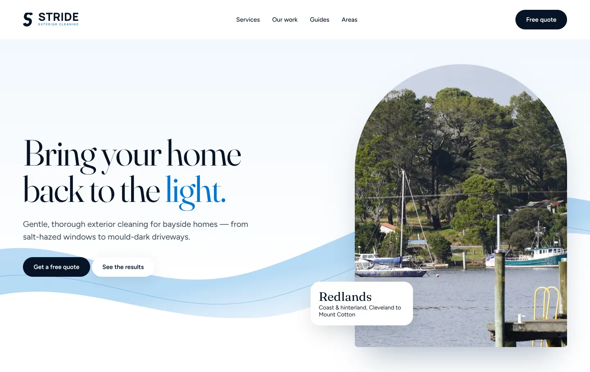

# Stride Exterior Cleaning: creative direction

This document records how the website's visual identity was developed: the brand analysis, the research, the three directions explored, how they were scored, and the system that was built from the winning direction.

The three concept mockups are in this folder (`concept-*.html`, screenshots in `screens/`). The full design research is in `research-notes.md`.

---

## 1. Brand analysis (approved logo, unchanged)

| Element | What it is | What it tells us |
|---|---|---|
| **The S mark** | A heavy, slanted S built from two interlocking curves, with terminals cut on a diagonal | Forward motion ("stride"), a sweep of water, a single confident gesture. The diagonal cut is the brand's one angle, so it became the site's motion and masking angle. |
| **Wordmark** | STRIDE in a bold, squared, wide geometric sans | Solid, engineered, trustworthy. Width = stability. |
| **Descriptor** | EXTERIOR CLEANING in light, widely tracked caps in Stride Blue | Precision, calm, technical. |
| **Navy `#061426`** | Almost-black navy | The text colour. Reads as ink, not as "dark mode". |
| **Stride Blue `#0076D1`** | Clear, saturated azure | Water, clarity and action. Used sparingly so it always means "do this" or "this is clean". |

**Personality:** precise, careful, quietly confident, local. The brand is not loud. It looks like a company that measures twice.

**Colour roles chosen**

- **Ground:** pure white `#FFFFFF`, with a cool paper tint `#F5F7F9` for the occasional band. The site is light by default; one navy band is used where contrast helps (the method/standard section and the footer).
- **Ink:** navy `#061426` for headings, `#3B4A5C` for body text, `#6B7A8C` for meta.
- **Action:** Stride Blue is used for primary buttons, links, focus rings, progress and the "clean" state in the 3D model, and nowhere decorative.
- **Lines:** hairlines `#E3E8EE`, the architectural-drawing layer.
- **Wash:** `#EAF4FC`, a pale blue used only for selected/active states.

**Typography**

- **Archivo** (variable, OFL): one family with a width axis. Headlines are set slightly *expanded* (wdth 108–114) at weight 600–640 to echo the wide STRIDE wordmark. Body text is normal width at weight 400. This is one file, about 90 KB.
- **IBM Plex Mono** (500): small uppercase "spec" labels such as `ROOF · SOFT WASH`, echoing the tracked EXTERIOR CLEANING descriptor and giving the site an architectural-drawing voice. It is used for data, never for prose.
- **Deliberately avoided:** Inter, Geist, Space Grotesk, Satoshi and serif-italic accent words. These are the fonts that make a site read as AI-generated or templated (see research notes).

---

## 2. Research summary

Full notes: `research-notes.md`. The decisive findings:

1. **The trade category is visually weak.** Premium cleaning sites win on mechanics (before/after, one CTA, reviews), not design. The visual language should come from **architecture practices and luxury-material brands**: generous white space, hairline grids, editorial captions, restrained colour and a project index.
2. **Before/after is the category's strongest trust device**, so the hero interaction should *be* a before/after, not decoration beside one.
3. **Performance constraints:** vanilla three.js lazy-loaded after paint (about 130 KB gzipped), with a poster image as the LCP element. Avoid React Three Fiber (about 308 KB) and Spline (about 563 KB plus the scene file).
4. **AI-template tells to avoid:** gradient meshes, glassmorphism, rows of identical icon cards, bento grids, animated counters, a tracked eyebrow over *every* heading, and stock testimonial avatars.

---

## 3. Three directions

### A. "The Maquette": architectural model

A white-clay **architectural model** of a typical Redlands home, rendered live in WebGL. It starts weathered the way SEQ weathers houses: lichen-dark roof, algae on render, a blackened driveway, dusty solar. A clean pass sweeps across it at the angle of the S, and visitors drag across the model to clean the rest themselves. Hotspots (`ROOF · SOFT WASH`) link to each service. The rest of the site borrows the language of an architect's drawing set: hairline grids, numbered indexes, spec labels and captioned figures.

### B. "Surface Library": material specimens

The site as a catalogue of materials: terracotta, render, aggregate, glass, sandstone. Each is shown as a tilted specimen tile, half dirty and half clean, with spec numbering. It uses large light-weight neo-grotesk type on a warm stone ground, and the hero is a 3D grid of specimen tiles.

### C. "Tide": bayside light

Soft, coastal and emotional: a refined serif headline, a flowing water ribbon in the shape of the S across a sky-to-white field, arch-masked photography and pill buttons. The hero is a WebGL water ribbon.

### Scoring (1–5)

| Criterion | A · Maquette | B · Surface Library | C · Tide |
|---|---|---|---|
| Visual quality | 5 | 4 | 4 |
| Brand consistency | 5: the S angle drives the motion; navy/blue roles are exact | 4 | 3: the serif fights the geometric wordmark |
| Customer trust | 5: shows *method*, not slogans | 4 | 3: feels like marketing |
| Conversion potential | 5: the 3D links straight into services and the quote | 3: CTA is secondary to the catalogue | 4 |
| Mobile usability | 4: the model needs careful framing | 3: a dense grid doesn't fold well | 4 |
| Performance | 4: WebGL, but lazy and with a poster | 3: six textured tiles | 4 |
| Fit for the Australian residential market | 5: a recognisable SEQ home and its real problems | 3: reads as commercial or industrial | 4: bayside, but generic |
| Originality / "not a template" | 5 | 4 | 2: serif + wave + arch is a 2024–26 template pattern |
| **Total** | **38** | **28** | **28** |

### Decision: A, "The Maquette", with B's spec layer

**Why A won:** it is the only direction where the spectacle *is* the sales argument. The visitor performs the before/after with their own hand, on a house that looks like theirs, and every dirty surface is a doorway to the service that fixes it. Its white-clay model aesthetic makes a light website feel *expensive* rather than empty: the white reads as "pristine", which is the product. It is also unmistakably Stride: the clean pass travels at the S mark's angle and the clean state is Stride Blue.

**What was taken from B:** the numbered spec-sheet voice (`01 · Roofs`, `METHOD · SOFT WASH`, `PRESSURE · LOW`), applied as a data layer on service pages, the surface index and the guides.

**What was rejected from C:** the gradient wave, the serif and the arch masks. C's local, bayside warmth survives in the *copy* and the local pages instead.

---

## 4. The Stride design system (as built)

- **Grid:** 12 columns with a 48 px desktop gutter and a 20 px mobile gutter. Content aligns to hairline rules that run edge to edge.
- **Type scale:**
  - Display is a fluid size from 44 to 92 px, expanded 112%, weight 640, tracking −0.035em.
  - H2 runs 34 to 60 px.
  - H3 runs 22 to 30 px.
  - Body is 17–18 px with 1.6 line height.
  - Mono labels are 11.5 px with 0.06em tracking.
- **The clean pass:** the one signature motion. Images, section reveals and before/after comparisons wipe on the S-terminal diagonal (about 24°). There is no bounce, parallax overload or confetti.
- **Figures, not stock:** every photograph is captioned like an architectural figure (`Fig. 04 — Exposed aggregate. Demonstration photograph.`). Licensed stock is always labelled as demonstration, and it is never passed off as Stride's work.
- **Original imagery:** the 3D maquette is rendered into stills for service pages, the guides and social images, so most of the site's imagery is owned outright.
- **Components:**
  - Square-cornered (4 px) buttons, with an arrow that advances on hover.
  - Index rows instead of card grids.
  - Spec strips and figure captions.
  - A diagonal before/after comparison.
  - A numbered process line.
  - Calm, high-contrast form controls with large hit areas.

---

## 5. UX and conversion psychology applied

| Principle | Where it's used |
|---|---|
| **Goal-gradient effect** | Quote flow: a progress line and "Step 2 of 3"; the first step is the easiest (tap the services you need). |
| **Foot-in-the-door / commitment** | The first quote question is a tap, not a text field; contact details come last, once the visitor is invested. |
| **Hick's law** | Five-item primary navigation; one primary CTA per screen; the services index has six primary items, with secondary services behind "More". |
| **Fitts's law** | Sticky mobile bar with Quote and Book in the thumb zone; 48 px minimum targets. |
| **Reciprocity** | Free premium guides with no email wall; an optional "send me the seasonal reminder" field is the only ask. |
| **Authority (earned)** | The education centre and the spec layer show expertise through specifics (methods, risks, aftercare) rather than adjectives. |
| **Honest social proof** | No invented reviews or counters. A Google rating slot appears only once a real rating is configured. Demonstration imagery is labelled. |
| **Loss framing, used gently** | "What staining costs you" content (render paint life, slip risk, gutter overflow damage), factual and sourced, never alarmist. |
| **Peak-end rule** | The thank-you page gives a clear "what happens next" timeline, a reference number and a useful guide download. |
| **Cognitive fluency** | Short sentences, generous spacing, one idea per section, consistent component patterns. |
| **Von Restorff (isolation)** | Stride Blue is reserved for action, so the primary button is always the most distinctive element on screen. |
| **Interactive engagement** | The hero drag-to-clean uses the IKEA/endowment effect: visitors who "clean" the house have mentally started the job. |

---

## 6. 3D hero: technical approach

- **Technology:** vanilla three.js (r170), bundled with esbuild and loaded only after first paint. Spline was rejected for runtime size and React Three Fiber as unnecessary.
- **Poster first:** the hero shows a pre-rendered still of the *same* scene (AVIF/WebP, rendered by the build in headless Chromium). The canvas fades in over it only once the first frame is ready, so LCP is never the canvas.
- **Cost controls:**
  - Renders on demand only (while animating, dragging or easing), so it is idle otherwise.
  - Pauses off-screen.
  - Device pixel ratio is capped at 1.5–1.75.
  - Shadow map rendering is limited, and there are no external textures: all grime is procedural in the shader.
- **Fallbacks:**
  - With `prefers-reduced-motion`, no WebGL, Data Saver or low memory/cores, the visitor gets the poster plus an accessible before/after slider between the dirty and clean renders. The interaction survives without the 3D.
  - Hotspots are real links in the DOM, so they work with a keyboard and screen reader whether or not WebGL runs.
- **Touch:** brushing only starts on a press that lands on the model; the page always scrolls normally.
